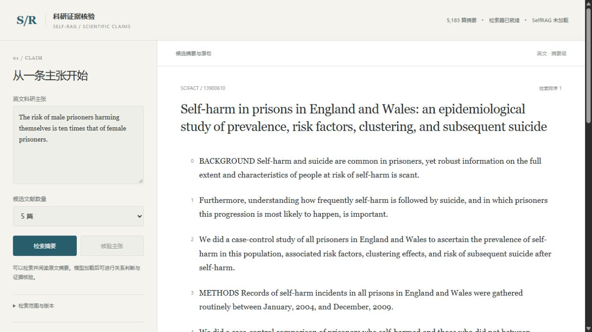

# Self-RAG 科研证据核验

检索一条英文科研主张的相关摘要，逐篇判断支持、反驳或信息不足，并将证据句映射回原始文献。网页保留原句编号、判断状态和模型版本，支持导出逐文献报告。

**Python · PyTorch / Transformers · PEFT / LoRA · Contriever · FAISS · FastAPI · SciFact**



## 当前验证

|项目|实际结果|
|---|---|
|公开源码|数据、检索、模型接口、LoRA训练、评测、API和网页|
|工程测试|51项通过，含微型随机Llama的B1/B2/B3训练、保存和冷重载|
|真实检索|5183篇摘要，固定Contriever与768维FAISS精确索引|
|train top-5检索诊断|gold文档召回486/564，即86.17%；至少命中一篇451/505，即89.31%|
|发布SelfRAG 7B|尚未加载权重；未运行正式领域训练或性能对照|
|来源分组|train对齐529/809；其余280条保留，完整来源划分未生成|

工程测试验证代码，检索诊断使用训练集。两者均不代表7B模型的关系判断成绩。详细记录见[验证说明](docs/VALIDATION.md)。

## 安装与测试

要求Python 3.12。以下命令在Windows PowerShell中执行，工作目录为仓库根目录。

```powershell
git clone https://github.com/GuoJianFei666/selfrag-scifact-verification.git
cd selfrag-scifact-verification
python -m venv .venv
& '.venv/Scripts/python.exe' -m pip install torch==2.6.0 --index-url https://download.pytorch.org/whl/cpu
& '.venv/Scripts/python.exe' -m pip install -e '.[test]'
& '.venv/Scripts/python.exe' -m pytest -q
```

`requirements-lock-cpu.txt`记录本次本机环境。GPU运行需要安装与设备匹配的PyTorch/CUDA；NF4为可选入口，本次未验证其CUDA兼容性。依赖安装不下载7B模型权重。

## 运行真实检索界面

先导入官方数据，再构建索引。运行文件放在忽略的`var/`目录。

```powershell
$env:OMP_NUM_THREADS = '4'
$env:MKL_NUM_THREADS = '4'
& '.venv/Scripts/python.exe' -m evidence_rag import-data --download `
  --archive var/downloads/scifact-data.tar.gz --output var/scifact
& '.venv/Scripts/python.exe' -m evidence_rag build-index `
  --data var/scifact --output var/contriever-index --cache var/model-cache `
  --revision 2bd46a25019aeea091fd42d1f0fd4801675cf699
.\Start.ps1
```

打开 <http://127.0.0.1:8787>。CPU首次构建索引需要下载Contriever权重并编码全部语料。数据和索引输出目录要求为空，已有输出可直接复用。页面显示实际服务状态；缺少模型时禁用核验按钮，接口返回503。

## 模型核验与训练

```powershell
& '.venv/Scripts/python.exe' -m evidence_rag fetch-model --cache var/model-cache --include-weights
```

该命令显式下载固定SelfRAG版本。准备好合适的运行环境，并将adapter及加载参数写入`configs/model.yaml`后，使用`Start.ps1 -WithModel`开启核验。默认只读取本地缓存。

领域训练前必须完成来源划分和干预语义复核：

```powershell
Invoke-WebRequest -Uri 'https://scifact.s3.us-west-2.amazonaws.com/release/latest/claims_with_citances.jsonl' `
  -OutFile var/downloads/claims_with_citances.jsonl
& '.venv/Scripts/python.exe' -m evidence_rag audit-sources --data var/scifact `
  --sources var/downloads/claims_with_citances.jsonl --audit var/source-audit.json --splits var/splits.json
```

当前公开来源文件有280条train主张未对齐，该命令会保存缺项后退出，不产生正式split。不会猜测来源组、随机分配缺项或静默删样本。完整操作见[训练与评测](docs/EXPERIMENTS.md)。

B1使用原始领域SFT；B2加入已复核干预；B3在同一SFT序列上增加方向与保持损失。模型选择只用内部model_select，校准只用calibration。正式dev运行绑定冻结的方法、视图、数据、模型、检索缓存及结果回执。

## 实现与阅读入口

|路径|职责|
|---|---|
|`evidence_rag/data.py`、`views.py`|原始数据、来源审计、替代证据视图、两轮复核|
|`evidence_rag/retrieval.py`|固定编码器、精确索引、真实检索缓存|
|`evidence_rag/serialization.py`、`model.py`|目标mask、完整标签概率、结构化生成和模型合约|
|`evidence_rag/training.py`|LoRA、配对损失、检查点、预算和重载|
|`evidence_rag/evaluation.py`、`protocol.py`、`workflow.py`|官方指标、联合诊断、校准和冻结输入|
|`evidence_rag/app.py`、`pipeline.py`、`web/`|FastAPI、来源绑定、报告和网页|
|`tests/`、`.github/workflows/`|工程测试及CPU CI|
|`data/`、`tools/inspect_public_data.py`|此前公开的数据来源与独立静态复核工具|

关系为`SUPPORT`、`CONTRADICT`、`NOINFO`，处理状态独立记录。范围限英文摘要级、逐文献核验。详见[架构](docs/ARCHITECTURE.md)、[输出契约](docs/DATA-CONTRACT.md)及[评价说明](docs/EVALUATION.md)。上游继承关系见[版本记录](UPSTREAM.md)和[第三方说明](THIRD_PARTY_NOTICES.md)。新增代码沿用[MIT许可](LICENSE)；模型权重和数据分别遵循上游许可，不随源码分发。
