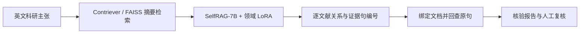

# Self-RAG 科研证据核验与溯源检索

围绕一条英文科研主张，检索相关摘要，逐篇判断支持、反驳或信息不足，并将证据句映射回原始文献。核验报告保留结论、原句依据和处理状态，供逐条复核。

**技术栈**：Python · PyTorch / Transformers · PEFT / LoRA · Contriever · FAISS · SelfRAG-7B · SciFact。

本仓库公开架构、数据与输出契约、评价方案、来源记录及公开数据复核工具。核验应用与领域适配源码暂不公开，模型权重不随仓库分发。

## 技术与个人工作

- **检索与数据**：冻结 Contriever 编码器，用标题与摘要建立 FAISS 精确索引；保留原始文档、句子编号与可替代证据集。先按主张来源组划分数据，再生成变体；变体继承父主张的划分。
- **领域适配**：基于已发布 SelfRAG-7B 组织领域 LoRA SFT，统一输入序列化与目标 token 监督，将检索摘要、关系标签和证据句选择统一到训练样本中。
- **引用回查**：模型选择当前视图中的句子编号，系统绑定文档、映射原始句子编号并取回原句，分别处理结构校验和证据语义判断。
- **评价设计**：使用 Full / Keep / Break / Neutral 证据视图区分完整信息、替代证据保留和证据破坏，分开报告关系、证据句、联合指标与引用有效性。
- **应用交付**：围绕科研信息检索生成逐文献核验报告，保留标题、文档 ID、原句、关系、处理状态与版本，支持人工复核。

## 处理流程

关系为 `SUPPORT`、`CONTRADICT`、`NOINFO`。处理状态与关系标签分别记录，执行失败保留为独立状态。范围为英文摘要级、逐文献核验。

## 阅读入口

| 内容 | 文件 |
| --- | --- |
| 组件与数据流 | [架构说明](docs/ARCHITECTURE.md) |
| 输入、输出与编号规则 | [数据契约](docs/DATA-CONTRACT.md) |
| 四视图与评价口径 | [评价说明](docs/EVALUATION.md) |
| 公开文件和使用路径 | [使用说明](docs/USAGE.md) |
| 公开数据复核记录 | [原有检查说明](docs/DATA-INSPECTION.md)、[机器结果](data/inspection-results.json) |
| 数据、模型和代码来源 | [来源与许可](docs/SOURCES.md)、[第三方说明](THIRD_PARTY_NOTICES.md) |

## 数据与结果口径

SciFact 的公开规模和划分见[数据检查记录](docs/DATA-INSPECTION.md)，属于上游公开数据。检索不读取 gold 关系、证据标签或 cited_doc_ids。已定义的 B0—B3 对照中，B3 配对目标仍待比较，尚无实测增益。本公开包不附个人 F1、训练耗时或企业采用指标。

项目说明与独立公开数据复核工具沿用 [MIT 许可](LICENSE)；SciFact、Self-RAG 代码与模型分别遵循上游许可。
